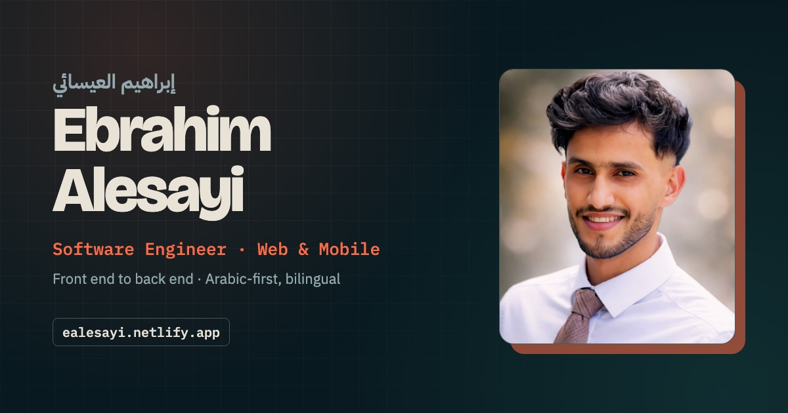

# Portfolio

Source for my personal site: **[ealesayi.netlify.app](https://ealesayi.netlify.app/)**



It's a single static page in English and Arabic, with a full right-to-left layout when you switch to Arabic, plus light and dark themes. There's no framework and no build step, just HTML, CSS and a bit of vanilla JavaScript, so it loads fast and is easy to keep up to date.

## What's inside

```
index.html            the site
projects/             walkthrough pages for apps that don't have a public URL
assets/img/           portrait, project screenshots, social preview card
assets/docs/          CV and project documents
_redirects            keeps old Netlify links working
```

## Running it locally

Open `index.html` in a browser, or serve the folder:

```bash
python3 -m http.server 8000
```

## Deploying

Netlify deploys the `main` branch as is. There's no build command, and the publish directory is the repo root.

## History

The early commits in this repo are my first portfolio (2022 to 2025), built on a Bootstrap template. I kept that history on purpose. The original repo is still up at [ealesayi/cv](https://github.com/ealesayi/cv).
